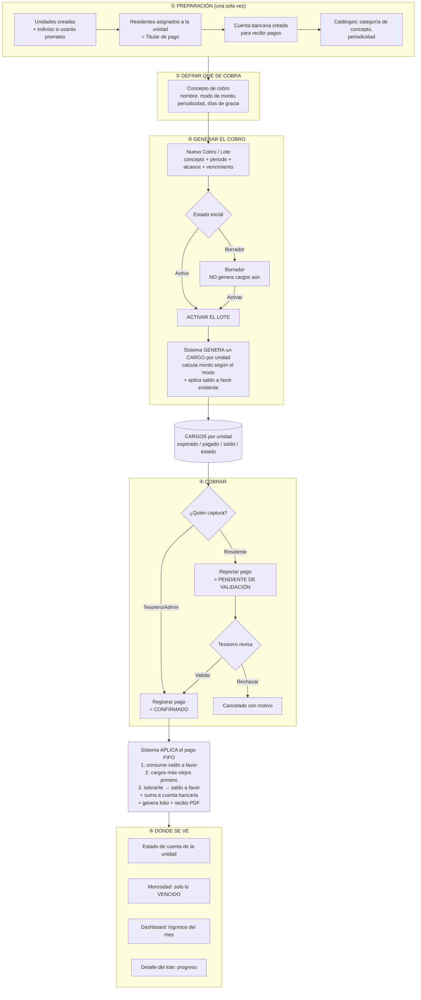
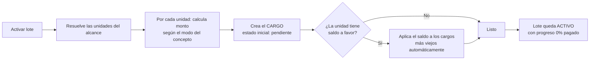
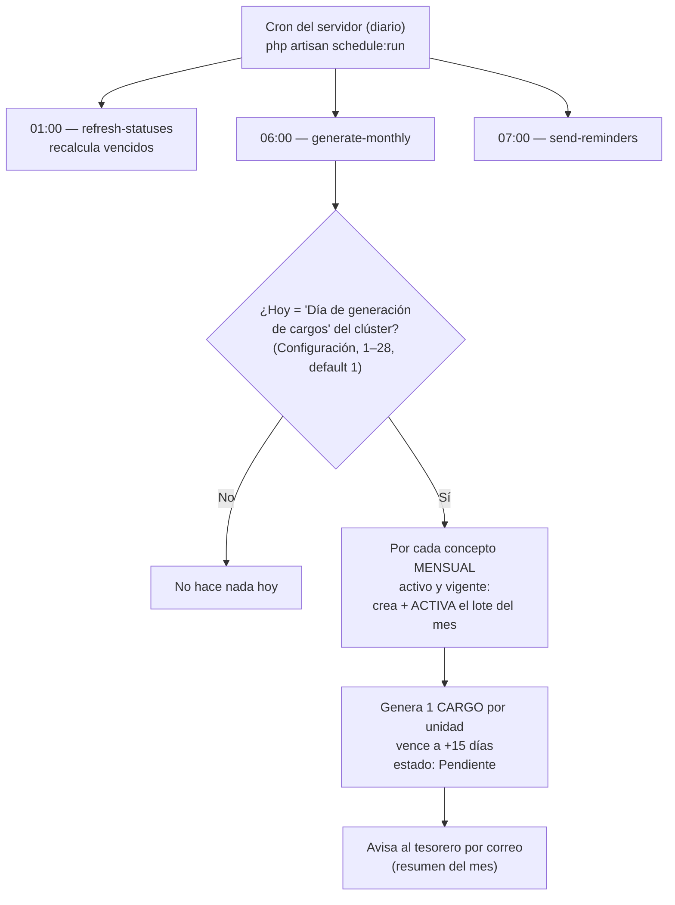
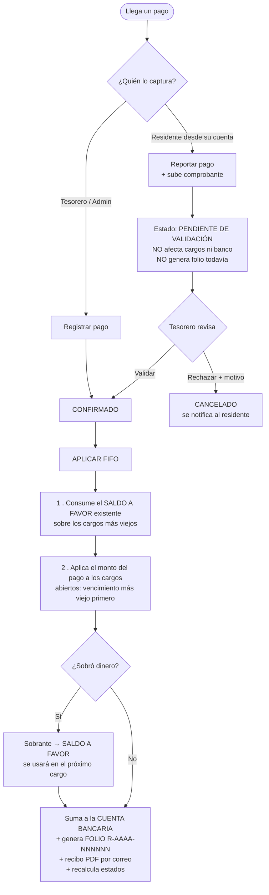
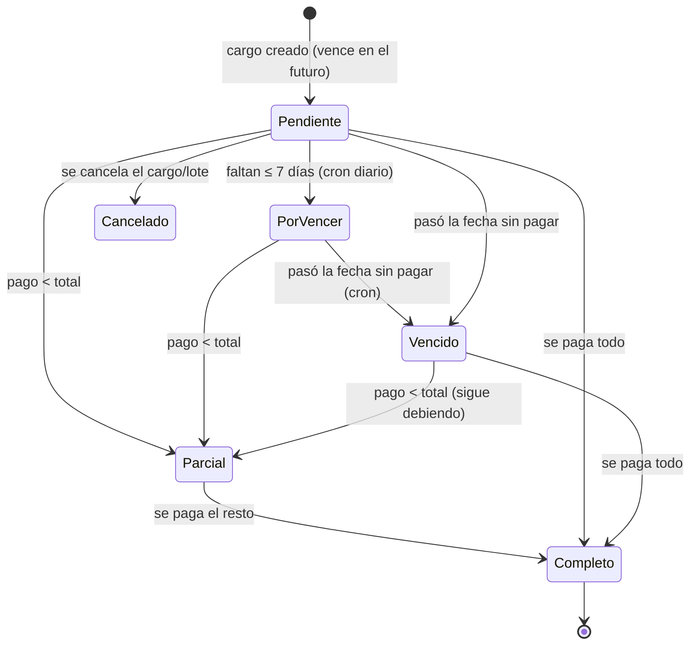
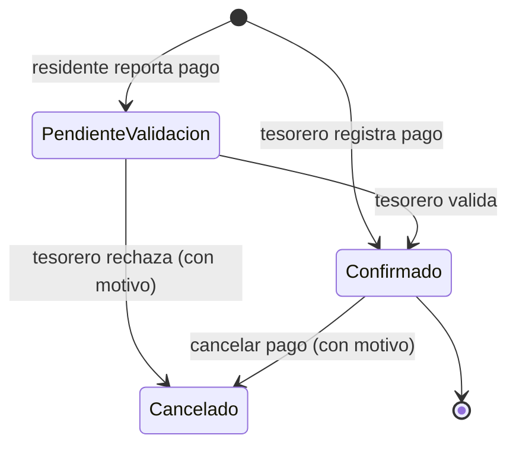

# Manual de Cobranza — Kivo7/Residia

Guía práctica del módulo de Cobranza: **qué hacer primero, qué registrar después, qué pasa en el sistema y dónde se ve cada dato.**

> Resumen en una frase: **Configuras CONCEPTOS → lanzas un COBRO (lote) y lo ACTIVAS → eso genera los CARGOS por unidad → registras PAGOS → el sistema aplica el dinero (FIFO) y actualiza estados, saldos, estado de cuenta y morosidad.**

---

## 1. Diagrama general de flujo



---

## 2. Paso a paso: ¿qué hago primero?

### ① Preparación (una sola vez por clúster)
| # | Acción | Pantalla | ¿Por qué es necesario? |
|---|---|---|---|
| 1 | Crear **Unidades** | Unidades → Nueva unidad | Sin unidades no hay a quién cobrar. Pon el **indiviso (%)** si vas a prorratear. |
| 2 | Asignar **residente** a cada unidad como **Titular de pago** | Detalle de unidad → Agregar persona | Define a quién se le cobra, quién ve el estado de cuenta y a quién llegan notificaciones/recibo. |
| 3 | Crear **Cuenta bancaria** | Tesorería → Cuentas Bancarias | Todo pago confirmado entra a una cuenta; sin cuenta no puedes registrar pagos. |
| 4 | Revisar **catálogos** | Cobranza → Catálogos (categorías de concepto) | Para clasificar los conceptos. |

### ② Definir qué se cobra
| # | Acción | Pantalla |
|---|---|---|
| 5 | Crear **Concepto de cobro** | Cobranza → Conceptos de Cobro → Nuevo concepto |

El **modo de monto** decide cuánto se cobra a cada unidad:

| Modo | Qué hace | Campo que pides |
|---|---|---|
| **Fijo obligatorio** | Mismo monto para todas | Monto fijo |
| **Fijo opcional** | Monto sugerido, se puede ajustar | Monto fijo |
| **Rango** | Mínimo/ideal/máximo (cobra el ideal) | Mínimo, Ideal, Máximo |
| **Libre** | El residente decide cuánto (ej. donativos) | — |
| **Por indiviso** | **Prorratea** un total entre las unidades según su % de indiviso | Monto total a prorratear |

### ③ Generar el cobro
| # | Acción | Pantalla |
|---|---|---|
| 6 | Crear **Cobro (lote)** | Cobranza → Cobros → Nuevo cobro |

Eliges: **concepto + año/mes + alcance + fecha de vencimiento**. El **alcance** (¿a quiénes aplica?):
`Todo el clúster` · `Por tipo de unidad` · `Por torre` · `Por piso` · `Selección manual` · `Por característica` · `Una sola unidad`.

**Estado inicial:**
- **Borrador** → lo guardas para revisar; **NO genera cargos todavía**.
- **Activo** → genera los cargos de inmediato.

| # | Acción | Resultado |
|---|---|---|
| 7 | **Activar** el lote (si era borrador) | El sistema **genera un CARGO por cada unidad del alcance**, calcula el monto y **aplica el saldo a favor** que tenga cada unidad. |

### ④ Cobrar (registrar pagos) — ver sección 4.

---

## 3. ¿Qué pasa internamente al ACTIVAR un lote?



- **Prorrateo (Por indiviso):** reparte el total entre las unidades según su indiviso, distribuyendo los centavos sobrantes para que **sume exacto** (sin descuadres).
- Una vez activo, los cargos ya aparecen en **Cargos**, en el **Estado de cuenta** de cada unidad y en el **detalle del lote**.

---

## 3-bis. ¿CUÁNDO se generan los cobros? (esto es clave)

Depende de la **periodicidad del concepto**:

### A) Conceptos MENSUALES → automático (no los creas a mano cada mes)
El sistema tiene un proceso (`collections:generate-monthly`) que **corre todos los días a las 06:00**. Cada día revisa, por clúster:



- Es **idempotente**: aunque el proceso corra a diario, solo genera **una vez** por concepto/mes (no duplica).
- El **vencimiento** del cargo mensual = día de generación **+ 15 días**.
- Solo aplica a conceptos con **periodicidad = Mensual**, **activos** y dentro de su **vigencia** (valid_from / valid_to).

**Ciclo mensual visto en el tiempo:**
```
Día 1, 06:00   → se generan los cargos del mes (estado: Pendiente)
Día ~9         → faltan ≤7 días → "Por vencer"
Día 16         → vencimiento (día 1 + 15); si no pagan → "Vencido"
Cada día 01:00 → el sistema recalcula y marca los vencidos → aparecen en MOROSIDAD
Cada día 07:00 → se envían recordatorios
```

### B) Conceptos EVENTUALES / especiales → manual
Cuotas especiales, extraordinarias, derramas, etc. **NO** son automáticas: las creas tú cuando las necesitas (Cobros → Nuevo cobro → elegir alcance → **Activar**).

### ⚠️ Requisito de producción (¡verificar antes de liberar!)
Toda la automatización mensual depende de que el **scheduler de Laravel esté corriendo** en el servidor. Debe existir este cron del sistema:

```cron
* * * * * cd /ruta/del/proyecto && php artisan schedule:run >> /dev/null 2>&1
```

- Procesos programados: `collections:refresh-statuses` (01:00), `collections:generate-monthly` (06:00), `collections:send-reminders` (07:00).
- **Si ese cron NO está activo, los cargos mensuales NO se generan solos**. Alternativa manual: correr `php artisan collections:generate-monthly` cada mes, o crear el lote a mano.

---

## 4. Cobrar: registrar un pago



**Aplicación automática (FIFO) vs manual:**
- **Automática (FIFO):** el sistema decide — primero saldo a favor, luego los cargos más viejos.
- **Manual:** tú eliges a qué cargos y cuánto aplicar. Si la suma manual es menor al pago, el resto va a saldo a favor. (No puedes aplicar más que el monto del pago.)

**Métodos:** Efectivo / Transferencia / Depósito / Cheque. El pago capturado por tesorero queda **Confirmado** (el dinero ya está). El reportado por el residente queda **Pendiente de validación** hasta que el tesorero lo valide.

---

## 5. Estados de un CARGO (qué significa cada color)



| Color | Estado | Significado |
|---|---|---|
| ⬜ / 🟡 | **Pendiente** | Cargo creado, aún no vence |
| 🟠 | **Por vencer** | Faltan ≤ 7 días y no se ha pagado |
| 🔴 | **Vencido** | Pasó la fecha de pago sin cubrirse → cuenta para **morosidad** |
| 🟡 | **Parcial** | Pagó una parte, falta el resto |
| 🟢 | **Completo** | Pagado al 100% |
| 🔵 | **Sobre pago** | Pagó de más → generó **saldo a favor** |
| ⚪ | **Cancelado** | Anulado (no cuenta) |

> Las transiciones por tiempo (pendiente → por vencer → vencido) las hace un **proceso diario automático**. Las transiciones por dinero (→ parcial/completo) ocurren **al instante** cuando registras o cancelas un pago.

---

## 6. Estados de un PAGO



- **Confirmado:** ya aplicado a cargos + sumado al banco + con folio.
- **Pendiente de validación:** capturado por el residente, todavía no afecta nada.
- **Cancelado:** se revierte todo (aplicaciones, saldo a favor, banco) y queda en auditoría con motivo. **El folio NO se reutiliza** (el recibo cancelado se conserva).

---

## 7. ¿Dónde se ve cada información y cuándo aparece?

| Quiero ver… | Pantalla | Aparece cuando… |
|---|---|---|
| Los cargos individuales y su estado | **Cobranza → Cargos** | Activas un lote (se generan los cargos) |
| La cuenta de UNA unidad (cargos, pagado, saldo, total) | **Estado de Cuenta** (busca la unidad) | Hay cargos generados; se actualiza al pagar |
| Mi cuenta como residente (1 o varias unidades + total general) | **Estado de Cuenta** (entra el residente) | Tienes unidad asignada como titular |
| Quién debe **vencido** (morosidad) | **Cobranza → Morosidad** | Un cargo pasa a **Vencido** (cron) |
| Avance de un cobro masivo | **Cobros → (abrir lote)** | El lote está activo |
| Ingresos del mes / adeudo / neto | **Dashboard** | Hay pagos **confirmados** del periodo |
| Saldo a favor de una unidad | **Estado de Cuenta** de la unidad | Hubo un sobrepago |
| Reportes (morosidad, ingresos vs egresos) PDF/Excel | **Reportes** | Siempre (genera con los datos actuales) |

> ⚠️ **Importante — "Adeudo vencido" vs "Adeudo total":**
> - **Morosidad** muestra **Adeudo vencido** = solo lo que ya pasó de fecha.
> - **Estado de cuenta** muestra **Adeudo total** = todo lo pendiente (vencido + por vencer + pendiente).
> Por eso una misma unidad puede verse con $250 en Morosidad y $670 en su estado de cuenta: son cosas distintas (vencido vs total).

---

## 8. Reglas clave que conviene recordar

1. **El dinero siempre va a los cargos más viejos primero** (FIFO) y el **saldo a favor se consume antes** que el efectivo del nuevo pago.
2. **Sobrepago = saldo a favor**, y se aplica solo en el **siguiente** cargo que se genere o en el siguiente pago.
3. **Cancelar un pago revierte todo** y mantiene el cuadre contable (incluso si el saldo a favor ya se había usado, lo "reclama" de los cargos).
4. **Un lote mensual es único** por concepto + periodo (no puedes crear dos "Mantenimiento Junio 2026" del mismo concepto).
5. **Días de gracia**: el cargo no se marca vencido sino hasta después del vencimiento + días de gracia.
6. **Condonación/descuento** en un cargo reduce lo que falta por pagar (no necesita efectivo).
7. **Dinero en centavos**: el sistema trabaja internamente en centavos para no perder precisión.

---

## 9. "No me aparece X" — checklist rápido

| Síntoma | Causa probable / qué revisar |
|---|---|
| No se generan cargos | El lote está en **Borrador** → actívalo |
| El cargo de prorrateo salió en $0 | La unidad no tiene **indiviso (%)** capturado |
| Registré un pago y no lo veo en la lista | Refresca; el pago se aplica al instante (ya corregido el refresco de la lista) |
| El residente ve un buscador en vez de su cuenta | Debe tener una **unidad asignada como titular** (si no, no hay cuenta propia) |
| La morosidad muestra menos que el estado de cuenta | Correcto: morosidad = **solo vencido**; estado de cuenta = **todo lo pendiente** |
| No llega el recibo | El pago debe estar **Confirmado** y la unidad tener un **titular con correo** |

---

### Orden mínimo para arrancar a cobrar (TL;DR)
**Unidad → Residente (titular) → Cuenta bancaria → Concepto → Cobro (lote) → Activar → Registrar pago.**

---

## 10. Referencia técnica — acción → qué cambia en el sistema

> Todos los montos se guardan en **centavos** (minor units): `150000` = $1,500.00.

### 10.1 Mapa Acción → Endpoint → Tabla/campos que cambian → Estado

| Acción (UI) | Endpoint API | Tabla(s) | Campos que se escriben / cambian | Estado resultante |
|---|---|---|---|---|
| Crear concepto | `POST /api/charge_concept` | `charge_concept` | `clave, name, charge_concept_category_id, amount_mode_id, fixed_amount` o `min/ideal/max_amount` o `prorate_total_amount`, `periodicity_id, grace_days, valid_from, valid_to, is_active` | — |
| Crear cobro (borrador) | `POST /api/charge_batch` | `charge_batch` | `charge_concept_id, title, year, month, target_type, target_selector, amount_override, issued_at, due_date`, `charge_batch_status_id = DRAFT`, `progress_pct = 0` | Lote: **Borrador** |
| Previsualizar alcance | `POST /api/charge-batch/preview` | — (solo lectura) | calcula unidades/montos sin escribir | — |
| **Activar cobro** | `POST /api/charge-batch/{id}/activate` | `charge_batch`, `charge`, (`payment_application`, `credit_balance`) | `charge_batch.charge_batch_status_id = ACTIVE`; **crea N `charge`** con `unit_id, charge_concept_id, charge_batch_id, expected_amount, paid_amount=0, discount_amount=0, issued_at, due_date, charge_status_id = PENDING`; si la unidad tenía saldo → crea `payment_application(source=credit)`, baja `credit_balance.amount`, sube `charge.paid_amount` | Lote: **Activa**; Cargos: **Pendiente** (o Parcial/Completo si hubo saldo) |
| Cancelar cobro | `POST /api/charge-batch/{id}/cancel` | `charge_batch`, `charge` | `charge_batch_status_id = CANCELLED`; sus `charge.is_cancelled = true`, `charge_status_id = CANCELLED` | Lote/Cargos: **Cancelado** |
| **Registrar pago** (tesorero) | `POST /api/payment/register` | `payment`, `payment_application`, `charge`, `bank_account`, `credit_balance`, `receipt_sequence` | crea `payment(total_amount, paid_at, payment_method_id, bank_account_id, reference, payment_status_id = CONFIRMED, receipt_number = R-AAAA-NNNNNN)`; crea `payment_application(payment_id, charge_id, applied_amount, source=cash\|credit)`; sube `charge.paid_amount` + recalcula `charge.charge_status_id`; sube `bank_account.current_balance`; sobrante → `credit_balance.amount`; sube `receipt_sequence.last_number` | Pago: **Confirmado**; Cargos: Parcial/Completo |
| Reportar pago (residente) | `POST /api/payment/submit` | `payment` (+ media comprobante) | crea `payment(payment_status_id = PENDING_VALIDATION, receipt_number = NULL)`. **No** toca cargos/banco/saldo | Pago: **Pendiente de validación** |
| Validar pago | `POST /api/payment/{id}/validate` | igual que *register* | `payment_status_id = CONFIRMED`, asigna `receipt_number`, **aplica FIFO** (misma ruta que register) | Pago: **Confirmado** |
| Rechazar pago | `POST /api/payment/{id}/reject` | `payment` | `payment_status_id = CANCELLED`, `cancellation_reason` | Pago: **Cancelado** |
| **Cancelar pago** | `POST /api/payment/{id}/cancel` | `payment`, `payment_application`, `charge`, `credit_balance`, `bank_account` | `payment_status_id = CANCELLED`, `cancellation_reason`; **borra** los `payment_application`; baja `charge.paid_amount` + recalcula estado; ajusta `credit_balance` (restaura/quita, con clawback); baja `bank_account.current_balance` | Pago: **Cancelado**; cargos recalculados |
| Condonar / descuento | `POST /api/charge/{id}/discount` | `charge` | `discount_amount` (+ recalcula estado: lo condonado reduce lo que falta) | Cargo recalculado |
| Cancelar cargo | `POST /api/charge/{id}/cancel` | `charge` | `is_cancelled = true`, `charge_status_id = CANCELLED` | Cargo: **Cancelado** |
| Ver estado de cuenta | `GET /api/unit/{id}/statement` | lectura | devuelve `charges[]`, `credit_balance_minor_units`, `totals{expected,paid,outstanding}` | — |
| Ver morosidad | `GET /api/delinquency` | lectura | unidades con cargos `OVERDUE`: `charge_count, oldest_due_date, outstanding_minor_units` | — |
| Generación mensual (cron) | `collections:generate-monthly` (06:00) | `charge_batch`, `charge` | igual que *activar*; idempotente por `(tenant_id, charge_concept_id, year, month)` | — |
| Refresco de estados (cron) | `collections:refresh-statuses` (01:00) | `charge` | `charge_status_id`: PENDING → DUE_SOON → OVERDUE según fechas + `grace_days` | — |

### 10.2 Catálogos de estado (claves / `key`)

| Catálogo | Claves posibles |
|---|---|
| `charge_status` (estado del cargo) | `PENDING`, `DUE_SOON`, `PARTIAL`, `OVERDUE`, `COMPLETED`, `OVERPAID`, `PAYMENT_PLAN` (v1.2, sin flujo aún) |
| `payment_status` (estado del pago) | `CONFIRMED`, `PENDING_VALIDATION`, `CANCELLED` |
| `charge_batch_status` (estado del lote) | `DRAFT`, `ACTIVE`, `CANCELLED` |
| `amount_mode` (modo de monto) | `FIXED_REQUIRED`, `FIXED_OPTIONAL`, `RANGE`, `FREE`, `BY_SHARE` |
| `periodicity` (periodicidad) | `MONTHLY`, `BIMONTHLY`, `YEARLY`, `EVENTUAL` |
| `payment_application.source` (origen de la aplicación) | `cash` (efectivo del propio pago) · `credit` (saldo a favor consumido) |

### 10.3 Diccionario de campos (columnas clave por tabla)

- **`charge`** (cargo): `unit_id`, `charge_concept_id`, `charge_batch_id`, `expected_amount`, `paid_amount`, `discount_amount`, `issued_at`, `due_date`, `charge_status_id`, `is_cancelled`.
  - *Saldo del cargo* = `expected_amount − discount_amount − paid_amount`.
- **`payment`** (pago): `unit_id`, `payer_user_id`, `paid_at`, `total_amount`, `payment_method_id`, `bank_account_id`, `reference`, `physical_receipt_number`, `receipt_number`, `payment_status_id`, `cancellation_reason`, `notes`.
- **`payment_application`** (aplicación): `payment_id` (NULL si la aplicó el sistema con saldo), `charge_id`, `applied_amount`, `source`.
- **`charge_batch`** (lote): `charge_concept_id`, `title`, `year`, `month`, `target_type`, `target_selector`, `amount_override`, `issued_at`, `due_date`, `charge_batch_status_id`, `progress_pct`.
- **`charge_concept`** (concepto): `clave`, `name`, `charge_concept_category_id`, `amount_mode_id`, `fixed_amount`, `min_amount`, `ideal_amount`, `max_amount`, `prorate_total_amount`, `grace_days`, `periodicity_id`, `valid_from`, `valid_to`, `is_active`.
- **`credit_balance`** (saldo a favor): `unit_id`, `amount`.
- **`bank_account`** (cuenta): `current_balance`.
- **`receipt_sequence`** (folios): `year`, `last_number` → genera `R-AAAA-NNNNNN`.

### 10.4 Invariante contable (siempre se cumple por unidad)
```
Σ(charge.paid_amount) + credit_balance.amount == Σ(payment.total_amount con estado CONFIRMED)
```
Si registras o cancelas pagos, esta igualdad siempre queda balanceada (incluido el clawback de saldo ya consumido).

### 10.5 Reglas de orden técnico (FIFO de aplicación)
1. Primero se consume `credit_balance` (saldo a favor) sobre los cargos abiertos más viejos.
2. Luego el `total_amount` del pago sobre cargos abiertos ordenados por `due_date ASC, issued_at ASC, id ASC`.
3. Sobrante → `credit_balance.amount` (saldo a favor).
4. Concurrencia: cargos, saldo y cuenta se bloquean (`lockForUpdate`) durante la operación.
