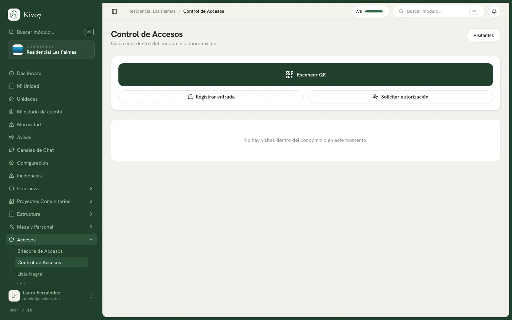

import { Steps, Aside, LinkCard, CardGrid } from '@astrojs/starlight/components';

**Control de Accesos** es la pantalla del vigilante. Muestra quién está dentro
del condominio ahora mismo y tiene las tres acciones de la caseta.

## Quién la usa

El rol **Seguridad** es el operador. También la ven el Administrador, y el
Presidente y el Tesorero en modo consulta.

## Quién está dentro ahora

La lista principal muestra cada visita que entró y no ha salido, con su nombre,
la casa que visita, el motivo, a qué hora entró y la placa. Se actualiza sola
cada 30 segundos.

Si alguien lleva **8 horas o más** dentro, aparece un aviso en ámbar con las
horas acumuladas. Es la señal para revisar si se fue sin registrar salida.

## Escanear un pase

<Steps>

1. Presiona **Escanear QR**.

2. Usa cualquiera de las tres vías:

   - **La cámara** — apunta al código del visitante.
   - **Un lector de códigos** — el campo mantiene el foco, solo dispara.
   - **A mano** — escribe el código en **Código del QR**.

3. Presiona **Registrar entrada**.

</Steps>

La entrada queda registrada con el nombre, la casa y la hora.

<Aside type="caution">
**La cámara solo funciona sobre una conexión segura.** Si la caseta abre Kivo7
por una dirección sin `https`, la vista de cámara no aparece y solo quedan el
lector y la captura manual — sin ningún mensaje que lo explique.

Si el vigilante reporta que "no sale la cámara", revisa eso antes que el
dispositivo.
</Aside>

### Si el pase no sirve

El sistema dice exactamente por qué: *QR no existe*, *QR ya fue usado*, *QR
cancelado por el residente*, *QR expirado*, *QR de evento válido solo el (fecha)*
o *Visitante o vehículo en lista negra*.

En todos los casos ofrece **Registrar entrada manual** como salida.

## Registrar una entrada a mano

Para cuando la visita llega sin pase y ya viene autorizada.

<Steps>

1. Presiona **Registrar entrada**.

2. Captura el **Nombre del visitante** y la **Unidad que visita**.

3. Elige la **Verificación** — cómo confirmaste que puede pasar. Es obligatoria.

4. Opcionalmente: **Motivo**, **Placa**, **Identificación** (INE, Pasaporte,
   Licencia u Otra) y su **Núm. de documento**.

5. Captura **Autorizado por** — el residente que dio el visto bueno.

6. Toma la **Foto del visitante** si el protocolo del condominio lo pide.

7. Presiona **Registrar entrada**.

</Steps>

### Los tres métodos de verificación

| Método | Cuándo se usa |
|---|---|
| **QR escaneado** | Se asigna solo al escanear un pase |
| **Aprobación remota (app)** | Se asigna solo cuando el residente autoriza desde su teléfono |
| **Llamada telefónica** | Lo eliges tú al registrar a mano, tras hablar con el vecino |

<Aside type="tip">
El campo **Autorizado por** es el que salva discusiones. "Entró porque la señora
de la Casa 12 lo autorizó por teléfono" solo existe si alguien lo escribió.
</Aside>

## Marcar la salida

Cada visita dentro tiene su botón **Registrar salida**. Un toque y queda.

<Aside type="tip">
Registrar salidas es la parte que más se descuida, y sin ella la lista de "quién
está dentro" deja de servir en una semana. Vale la pena revisarla al cambio de
turno y cerrar las que ya se fueron —dejando nota en la
[corrección](/docs/accesos/bitacora-de-accesos) si hace falta.
</Aside>

## Si alguien está en la lista negra

El sistema **no lo deja pasar en silencio**: registra la entrada como **Denegada**
—queda en la bitácora— y manda una alerta inmediata al Administrador y al
personal de seguridad, con el motivo.

## Relacionado

<CardGrid>
  <LinkCard
    title="Autorización remota"
    href="/docs/accesos/autorizacion-remota"
    description="Cuando no puedes localizar al residente por teléfono."
  />
  <LinkCard
    title="Bitácora de accesos"
    href="/docs/accesos/bitacora-de-accesos"
    description="El registro de todo lo que pasó por la caseta."
  />
  <LinkCard
    title="Lista negra"
    href="/docs/accesos/lista-negra"
    description="A quién no se le permite entrar."
  />
</CardGrid>
