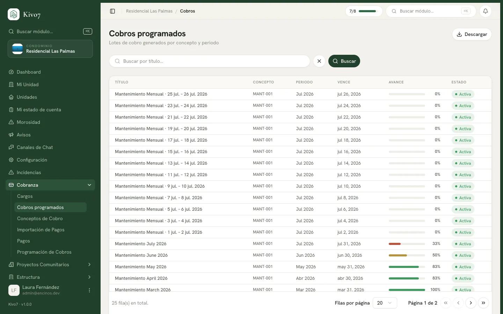

import { Steps, Aside, LinkCard, CardGrid } from '@astrojs/starlight/components';

Un cobro programado — o lote — es la emisión de un periodo. "Los cargos de marzo".
Toma una programación, resuelve a qué casas alcanza, calcula el monto de cada una
y crea un cargo por casa.

Es el momento en que la deuda se vuelve real para los vecinos.

## Quién puede usarlo

| Acción | Quién |
|---|---|
| Crear y activar cobros | Administrador · Tesorero · Presidente |
| Consultarlos y exportar | Los anteriores · Secretario · Vocal · Comité de Vigilancia |

## Antes de empezar

Necesitas una [programación de cobro](/docs/cobranza/programacion-de-cobros)
activa. El lote no define nada por su cuenta: hereda el monto, el alcance y los
tiempos de ella.

## Crear un cobro

<Steps>

1. Entra a **Cobros programados** y presiona el botón de alta.

2. Elige la **Programación de cobros**. Cada opción se lee con su concepto, su
   monto y su periodicidad, para que no te equivoques de regla.

3. Captura el **Año** y el **Mes**. En un cobro eventual —una derrama— deja
   **Sin mes**.

4. Revisa el panel **Programación aplicada (solo lectura)**: monto, periodicidad,
   días de gracia y modo. Es lo que vas a emitir.

5. El **Título** se autocompleta con el concepto y el periodo. Puedes ajustarlo:
   es lo que el vecino verá.

6. Revisa el **Alcance** y su vista previa: *N unidades incluidas*.

7. Captura la **Fecha de generación** y el **Vencimiento**.

8. En **Estado inicial**, elige:

   - **Borrador (revisar antes de activar)** — recomendado.
   - **Activo (genera cargos ya)** — emite de inmediato.

9. Presiona **Crear cobro**.

</Steps>

<Aside type="tip">
Elige siempre **Borrador** la primera vez que uses una programación nueva. Te deja
revisar el lote completo antes de que ningún vecino se entere.
</Aside>

## Revisar antes de activar

Al abrir un lote en borrador ves cuatro indicadores:

- **Total esperado** y cuántos cargos se generaron
- **Total pagado**, con su porcentaje de avance
- **Total faltante** y cuántos cargos siguen sin cubrirse
- **Vencidos**

Y dos pestañas: **Por unidad**, con el detalle casa por casa, y **Por estado**,
con el resumen de completos, parciales y sin pago.

Aquí es donde se cachan los errores. La cuenta rápida: número de casas por el
monto de la cuota debe darte el total esperado. Si no cuadra, algo está mal en el
alcance o en la programación.

## Activar el lote

<Steps>

1. Con el lote en borrador, presiona **Activar y generar cargos**.

2. Confirma en el diálogo **Activar cobro**: *Se generarán los cargos para las
   unidades del alcance.*

3. Presiona **Activar**.

</Steps>

Los cargos nacen en estado **Pendiente** y los vecinos empiezan a verlos.

<Aside type="caution">
**Activar no se deshace desde la aplicación.** Hoy no hay un botón para cancelar
un lote ya emitido: si te equivocaste, tendrías que
[cancelar los cargos](/docs/cobranza/cargos) uno por uno, y solo se pueden
cancelar los que todavía no tienen pagos aplicados.

Dedícale cinco minutos a la previsualización. Es la diferencia entre corregir en
silencio y explicarle a 48 vecinos por qué les llegó un cobro equivocado.
</Aside>

## Estados de un lote

| Estado | Qué quiere decir |
|---|---|
| **Borrador** | Creado pero sin emitir. Nadie lo ve. |
| **Activa** | Emitido. Los cargos existen y los vecinos los ven. |
| **Cancelada** | Anulado junto con todos sus cargos. |

## Cobros automáticos

Cuando una programación es periódica, Kivo7 genera sus lotes solo, con la
cadencia configurada. En ese caso el formulario te avisa:

> Esta programación se genera automáticamente cada mes. Usa este formulario solo
> para un cobro fuera de calendario (adelantar o reemitir).

## Relacionado

<CardGrid>
  <LinkCard
    title="Cargos"
    href="/docs/cobranza/cargos"
    description="Lo que genera el lote, casa por casa."
  />
  <LinkCard
    title="Programación de cobros"
    href="/docs/cobranza/programacion-de-cobros"
    description="De dónde saca el lote el monto y el alcance."
  />
</CardGrid>
