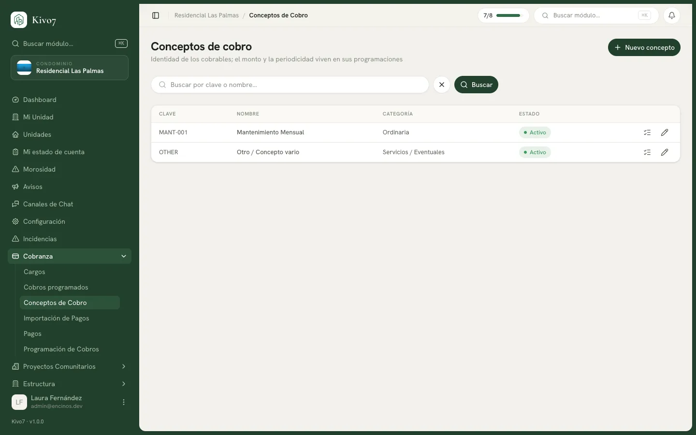

import { Steps, Aside, LinkCard, CardGrid } from '@astrojs/starlight/components';

Un concepto de cobro es **qué** se cobra. Nada más.

La cuota de mantenimiento es un concepto. La de vigilancia es otro. La derrama
para el portón es un tercero. Cada uno tiene su clave, su nombre y su categoría.

<Aside type="note">
El concepto **no lleva monto, ni periodicidad, ni días de gracia**. Todo eso vive
en la [programación de cobro](/docs/cobranza/programacion-de-cobros). La pantalla
lo dice: *la identidad de los cobrables; el monto y la periodicidad viven en sus
programaciones*.

Es la distinción que más cuesta al principio, y la que permite que un mismo
concepto tenga la cuota de 2026 a $1,500.00 y la de 2027 a $1,650.00 sin
duplicar nada.
</Aside>

## Quién puede usarlo

| Acción | Quién |
|---|---|
| Crear y editar conceptos | Administrador · Presidente · Tesorero |
| Consultarlos | Los anteriores · Secretario · Vocal · Comité de Vigilancia |

## Crear un concepto

<Steps>

1. Entra a **Conceptos de cobro** y presiona **Nuevo concepto**.

2. Captura la **Clave única**. Solo mayúsculas, números y guión bajo:
   `MANT_MENSUAL`, `VIGILANCIA`, `DERRAMA_PORTON`.

3. Captura el **Nombre visible**: cómo lo va a leer el vecino en su estado de
   cuenta. *Cuota de mantenimiento*.

4. Elige la **Categoría**. Sirve para agrupar en los reportes.

5. Deja **Activo** encendido y presiona **Guardar concepto**.

</Steps>

<Aside type="caution">
**La clave no se puede cambiar después.** Al editar un concepto, ese campo
aparece bloqueado. Piénsala una vez: es la referencia con la que el concepto vive
para siempre.
</Aside>

## Qué poner en la clave

La clave es interna, pero se usa en los listados y en los archivos de
exportación. Un par de recomendaciones:

- Que se lea sola: `MANT_MENSUAL` es mejor que `C1`.
- Sin el año adentro. `MANT_2026` te obliga a crear un concepto nuevo cada enero;
  el año va en la programación, no aquí.

## Desactivar un concepto

Los conceptos **no se eliminan** desde la aplicación: no hay botón de borrar.
Cuando dejas de usar uno, apaga el interruptor **Activo**.

Deja de estar disponible al crear programaciones y cobros nuevos, pero los cargos
históricos conservan su concepto y los reportes de años anteriores siguen
cuadrando.

## Qué sigue

Un concepto solo no cobra nada. Necesita al menos una programación que diga a
quién, cuánto y cada cuándo. Desde la lista, el icono de lista de cada renglón te
lleva directo a las programaciones de ese concepto.

<CardGrid>
  <LinkCard
    title="Programación de cobros"
    href="/docs/cobranza/programacion-de-cobros"
    description="El siguiente paso: definir el monto, el alcance y la periodicidad."
  />
  <LinkCard
    title="Cómo funciona la cobranza"
    href="/docs/cobranza/como-funciona"
    description="El modelo completo, si todavía no lo has leído."
  />
</CardGrid>
