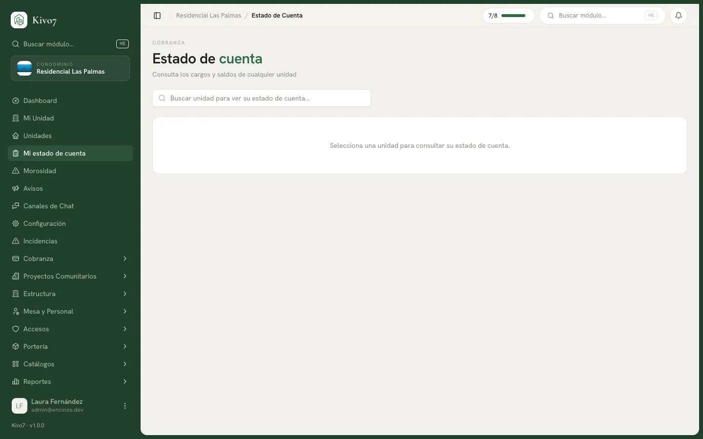

import { Steps, Aside, LinkCard, CardGrid } from '@astrojs/starlight/components';

El estado de cuenta es la foto completa de una casa: cuánto debe, cuánto tiene a
favor, cuánto ha pagado en total y el detalle de cada cargo.

Es la pantalla que más consultan los vecinos y la que más rápido resuelve una
discusión.

## Dos vistas de la misma pantalla

Kivo7 muestra una cosa u otra según quién entre.

### Si eres residente

Ves **tus** casas. Si tienes más de una, arriba aparece un consolidado —
**Total general**— con tres tarjetas: **Adeudo total**, **Saldo a favor** y
**Pagado histórico**. Debajo, una sección por casa con su propio detalle.

Desde aquí está el botón **Reportar pago**.

### Si eres administración

No tienes casas propias, así que la pantalla te ofrece un buscador:
*Buscar unidad para ver su estado de cuenta…*

Eliges una casa y ves lo mismo que vería su dueño, más el botón **Registrar
pago**.

## Qué muestra

Tres indicadores por casa:

| Indicador | Qué es |
|---|---|
| **Adeudo total** | Lo que debe hoy. En rojo si es mayor a cero. |
| **Saldo a favor** | Lo que pagó de más y todavía no se usa. |
| **Pagado histórico** | Todo lo que ha pagado esa casa desde siempre. |

Y una tabla de cargos con: **Concepto · Periodo · Emitido · Esperado · Pagado ·
Saldo · Estado**.

La tabla está paginada de 20 en 20 y ordenada por vencimiento, del más viejo al
más nuevo. **No incluye los cargos cancelados**: lo que aparece es lo que
realmente se debe.

## Los datos para transferir

Si el condominio lo tiene activado, arriba aparece **Datos para transferencia**
con la cuenta, el banco, el número y la CLABE, más un botón para copiar la CLABE
de un toque.

<Aside type="tip">
Vale la pena tenerlo encendido. Es la diferencia entre que el vecino transfiera
en 30 segundos y que escriba al grupo preguntando "¿a qué cuenta deposito?" por
enésima vez.
</Aside>

## Registrar o reportar un pago desde aquí

Los dos botones hacen cosas distintas y los ve gente distinta:

- **Reportar pago** — lo ve el residente. Avisa que ya pagó y queda pendiente de
  validación.
- **Registrar pago** — lo ve la administración. El pago nace confirmado y se
  aplica de inmediato.

→ [Pagos](/docs/cobranza/pagos)

## Cómo usarlo para resolver una queja

El caso típico: un vecino dice que ya pagó y sigue apareciendo como moroso.

<Steps>

1. Busca su casa en el estado de cuenta.

2. Mira el **Adeudo total**. Si es cero, ya está resuelto y lo que veía era
   información vieja en su teléfono.

3. Si debe, revisa la tabla de cargos: busca cuál está en **Vencido**.

4. Entra a [Pagos](/docs/cobranza/pagos), filtra por su casa y revisa si hay uno
   en **Pendiente de validación**. Es la causa más común: pagó, lo reportó, y
   nadie lo ha validado.

5. Si el pago existe y está confirmado pero el cargo sigue abierto, revisa el
   detalle del pago: probablemente se aplicó a un cargo más viejo, que es el
   comportamiento correcto.

</Steps>

## Relacionado

<CardGrid>
  <LinkCard
    title="Pagos"
    href="/docs/cobranza/pagos"
    description="Registrar, reportar y validar."
  />
  <LinkCard
    title="Saldo a favor y folios"
    href="/docs/cobranza/saldo-a-favor"
    description="Qué pasa con el dinero que sobra."
  />
  <LinkCard
    title="Morosidad"
    href="/docs/cobranza/morosidad"
    description="La vista de todas las casas con adeudo, no solo una."
  />
</CardGrid>
