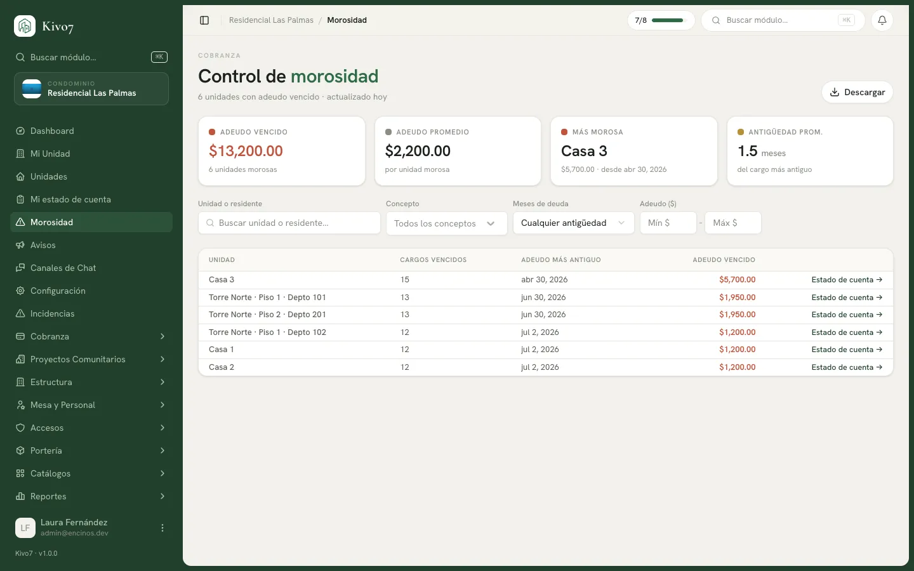

import { Steps, Aside, LinkCard, CardGrid } from '@astrojs/starlight/components';

El panel de morosidad responde una sola pregunta: **quién debe, cuánto y desde
cuándo**.

Es la pantalla de trabajo del cierre de mes y la que se lleva impresa a la junta
de mesa directiva.

## Quién puede usarlo

Administrador, Tesorero y Presidente. El Comité de Vigilancia puede consultarlo
sin exportar.

## Qué muestra

Cuatro indicadores arriba:

| Indicador | Qué es |
|---|---|
| **Adeudo vencido** | El total vencido, y cuántas casas lo deben |
| **Adeudo promedio** | Cuánto debe en promedio cada casa morosa |
| **Más morosa** | El adeudo mayor y desde cuándo |
| **Antigüedad prom.** | Cuántos meses tiene en promedio el cargo más viejo |

Y la tabla: **Unidad · Cargos vencidos · Adeudo más antiguo · Adeudo vencido**,
con un enlace por renglón al estado de cuenta de esa casa.

<Aside type="note">
**Los indicadores reflejan lo que estás filtrando**, no el total del condominio.
Si filtras por la cuota de mantenimiento, el *Adeudo vencido* es solo el de esa
cuota. Es útil, pero hay que tenerlo presente antes de citar la cifra en una
asamblea.
</Aside>

## Los filtros

| Filtro | Para qué |
|---|---|
| **Unidad o residente** | Buscar una casa concreta, por número o por nombre del vecino |
| **Concepto** | Aislar la morosidad de un solo cobro |
| **Meses de deuda** | Cualquier antigüedad, 1+, 2+, 3+, 6+ o 12+ meses |
| **Adeudo ($)** | Por rango de monto |

## Cómo se usa en la práctica

<Steps>

1. **Empieza por lo viejo.** Filtra por **3+ meses**: es el grupo que de verdad
   pone en riesgo las finanzas del condominio, y suele ser corto.

2. **Después por monto.** Ordena mentalmente por adeudo: cinco casas grandes
   suelen pesar más que treinta chicas.

3. **Descarga la lista.** El botón **Descargar** exporta a Excel **respetando los
   filtros activos**. Esa es la lista de trabajo.

4. **Entra al estado de cuenta** de cada casa desde el enlace del renglón, para
   ver el detalle antes de llamar.

</Steps>

<Aside type="tip">
Antes de contactar a nadie, revisa la pestaña **Pendientes de validación** en
[Pagos](/docs/cobranza/pagos). Es común que una casa aparezca morosa solo porque
su pago reportado no se ha validado. Llamar a un vecino que ya pagó cuesta más
que cinco minutos de revisión.
</Aside>

## Cuando no hay nadie moroso

Si el condominio está al corriente, la pantalla lo dice sin rodeos:

> 🎉 Ninguna unidad tiene saldo vencido. El condominio está al corriente.

Si aparece ese mensaje pero tú esperabas ver morosos, revisa que no tengas un
filtro activo de un cobro anterior.

## Qué cuenta como moroso

Solo las casas con cargos en estado **Vencido**: pasó la fecha de vencimiento más
los días de gracia sin cubrirse.

Una casa en **Parcial** —que pagó algo y aún está en plazo— **no aparece aquí**.
Debe, pero no está en mora.

## Relacionado

<CardGrid>
  <LinkCard
    title="Restricciones por morosidad"
    href="/docs/cobranza/restricciones-por-morosidad"
    description="Condicionar amenidades, visitas y paquetes al día."
  />
  <LinkCard
    title="Estado de cuenta por unidad"
    href="/docs/cobranza/estado-de-cuenta"
    description="El detalle de una casa concreta."
  />
  <LinkCard
    title="Recargos por mora"
    href="/docs/cobranza/recargos-por-mora"
    description="La penalización por pagar tarde."
  />
</CardGrid>
