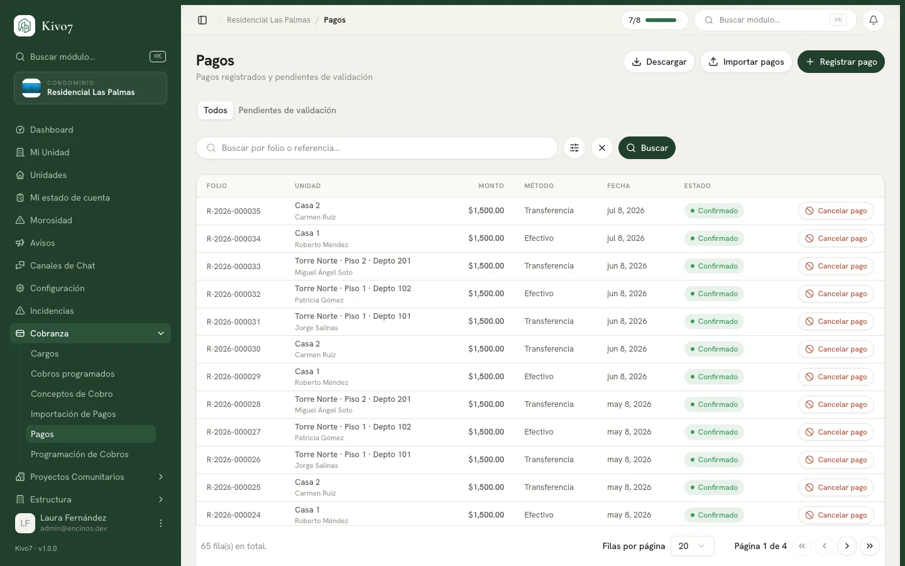

import { Steps, Aside, LinkCard, CardGrid, Tabs, TabItem } from '@astrojs/starlight/components';

Un pago es el dinero que entra a la cuenta del condominio a nombre de una casa.
Kivo7 lo reparte solo entre los cargos que esa casa debe, empezando por el más
viejo, y genera un folio de recibo.

Hay dos caminos según quién captura:

- **La administración registra el pago.** Se confirma en el momento y se aplica
  de inmediato.
- **El residente reporta su pago.** Queda pendiente hasta que alguien lo valida.
  Mientras tanto no toca ningún cargo.

## Quién puede usarlo

| Acción | Quién |
|---|---|
| Registrar, validar, rechazar y cancelar pagos | Administrador · Tesorero · Presidente |
| Reportar su propio pago | Residente · Arrendatario |
| Descargar el listado a Excel | Administrador · Tesorero · Presidente |

<Aside type="note">
El **Presidente** también puede validar, rechazar y cancelar pagos, no solo el
Tesorero. Vale la pena saberlo al repartir responsabilidades en la mesa.
</Aside>

## Antes de empezar

- La casa debe estar dada de alta. → [Unidades](/docs/estructura/unidades)
- Debe existir al menos una **cuenta bancaria o caja**.
  → [Cuentas bancarias y caja](/docs/tesoreria/cuentas-bancarias)
- Para que el pago se aplique a algo, la casa debe tener cargos pendientes. Si no
  los tiene, el pago se registra igual y queda como saldo a favor.

## Registrar un pago

Es el camino de la administración: el dinero ya está en la cuenta y se captura
para que quede aplicado.

<Steps>

1. Entra a **Pagos** y presiona **Registrar pago**. Se abre un panel a la derecha.

2. Elige la **Unidad**. En cuanto la seleccionas aparece su resumen de deuda:
   cuánto debe en total, cuántos cargos pendientes tiene y si trae saldo a favor.

3. Captura la **Fecha de pago** y el **Monto total**.

4. Elige el **Método de pago**: Efectivo, Transferencia, Depósito o Cheque.

5. Elige la **Cuenta destino**, la cuenta o caja donde entró el dinero.

6. Si el método no es efectivo, sube el **Comprobante**. Es obligatorio para
   transferencia, depósito y cheque. Acepta PDF, JPG, PNG o WEBP, hasta 10 MB.

7. Opcionalmente captura la **Referencia** (el número de operación de la
   transferencia) y el **Folio recibo físico** si entregaste un recibo de papel.

8. Revisa la **Vista previa de aplicación**: te muestra a qué cargos va a ir el
   dinero, cargo por cargo, y cuánto quedaría de saldo a favor.

9. Presiona **Registrar pago**.

</Steps>

Aparece la confirmación con el folio asignado, por ejemplo
*Pago registrado · folio R-2026-000123*.

### Aplicación automática o manual

Por defecto la aplicación es **Automática (FIFO)**: el dinero se va a los cargos
más viejos primero. Es lo correcto casi siempre y es lo que evita discusiones.

Puedes cambiar a **Manual** cuando el vecino paga algo específico — la derrama
del portón, no la cuota atrasada. Marcas cada cargo y capturas cuánto va a cada
uno. Lo que no repartas queda como saldo a favor.

<Aside type="caution">
Aplicar manualmente y saltarse un cargo vencido deja a esa casa en morosidad
aunque acabe de pagar. Si lo haces a propósito, déjalo anotado en **Notas**: la
siguiente persona que revise el estado de cuenta no va a saber por qué.
</Aside>

### Cobro directo

Si el vecino paga algo que no tiene cargo previo — una reposición de tarjeta, una
multa — usa **Cobro directo (servicio eventual)** en lugar de **Cargos
pendientes**. Kivo7 crea el cargo y registra su pago en una sola acción.

Ahí eliges un **Concepto** del catálogo, o **Otro (especificar motivo)** y
escribes el **Motivo del cobro**. En este modo no hay reparto FIFO: el pago queda
pegado al cargo que acabas de crear.

→ [Cargo directo](/docs/cobranza/cargo-directo)

## Reportar un pago (residente)

<Steps>

1. El residente entra a **Mi estado de cuenta** y presiona **Reportar pago**.

2. Captura **Fecha de pago**, **Monto** y **Método de pago**.

3. Sube el **Comprobante**. Es obligatorio salvo que haya pagado en efectivo.

4. Presiona **Enviar pago**.

</Steps>

El residente **no elige la cuenta destino** ni decide cómo se reparte su dinero:
Kivo7 usa la cuenta principal del condominio y el reparto lo define quien valida.

El pago queda en **Pendiente de validación**. Mientras esté así **no baja su
deuda, no genera folio y no suma a la cuenta bancaria**. Es solo un aviso de
"ya pagué, revísenlo".

<Aside type="tip">
Explícale esto a los vecinos desde el principio. La queja más común es "ya pagué
y sigo apareciendo como moroso", y casi siempre es un pago reportado que nadie ha
validado todavía.
</Aside>

## Validar, rechazar o cancelar

Los pagos reportados se revisan en la pestaña **Pendientes de validación**.

<Tabs>
<TabItem label="Validar y aplicar">

Confirma el pago. Se le asigna folio, se aplica a los cargos, suma al saldo de la
cuenta y se le notifica al residente.

Es el momento en que el pago "existe" de verdad para la contabilidad.

</TabItem>
<TabItem label="Rechazar">

Para cuando el comprobante no corresponde, el monto no coincide o el pago no
llegó. **Pide un motivo obligatorio.**

El residente recibe una notificación con ese motivo y puede volver a subir un
comprobante corregido.

</TabItem>
<TabItem label="Cancelar pago">

Para deshacer un pago **ya confirmado**: se revierten todas sus aplicaciones a
cargos y se resta de la cuenta bancaria. Pide un motivo de al menos 5 caracteres
y queda registrado en la auditoría.

</TabItem>
</Tabs>

<Aside type="caution">
**Cancelar un pago no le avisa a nadie.** El dinero se revierte y la casa vuelve
a aparecer con deuda, pero el residente no recibe ninguna notificación. Si
cancelas un pago que él reportó, avísale por fuera.
</Aside>

## Qué significa cada estado

| Estado | Qué quiere decir |
|---|---|
| **Confirmado** | El dinero está reconocido: aplicado a los cargos, con folio y sumado a la cuenta. |
| **Pendiente de validación** | El residente lo reportó y nadie lo ha revisado. No afecta nada todavía. |
| **Cancelado** | Pago anulado. Sus aplicaciones se revirtieron. |

<Aside type="note">
No existe un estado "Rechazado". Un pago rechazado aparece como **Cancelado**, y
el motivo que escribiste se muestra en el detalle bajo **Motivo de cancelación**.
</Aside>

## Qué pasa después

Cuando un pago queda confirmado, en este orden:

1. **Se genera el folio de recibo**, con formato `R-2026-000123`: la letra R, el
   año y un consecutivo. Es único por condominio y por año.
2. **Se consume primero el saldo a favor** que la casa ya tenía.
3. **Se aplica el dinero a los cargos**, del más viejo al más nuevo, hasta
   agotarlo.
4. **Lo que sobra queda como saldo a favor** de la casa, y se usa solo en el
   próximo cobro.
5. **Se recalcula el estado de la casa.** Manda el peor cargo que le quede: si
   tiene uno vencido, la casa sigue apareciendo como vencida aunque haya pagado
   los demás.
6. **Sube el saldo de la cuenta bancaria** por el monto total del pago.
7. **Se notifica al titular de pago** de esa casa, y si quedó saldo a favor
   también se le avisa.
8. **Se genera el recibo en PDF** y se le envía por correo. Queda disponible en
   el detalle del pago y en su estado de cuenta.

## El detalle de un pago

Al hacer clic en cualquier renglón se abre el detalle, con el folio como título.
Lo importante está en la tarjeta **Aplicación a cargos (FIFO)**: el desglose de a
qué cargo se fue cada peso, con el concepto y el periodo.

Si dice *Este pago aún no se aplicó a ningún cargo*, es que sigue pendiente de
validación.

También encontrarás **Comprobantes**, con dos archivos distintos: el
**Recibo del sistema** que genera Kivo7, y el **Comprobante subido** por quien
capturó el pago.

## Preguntas que salen siempre

**¿Y si el vecino paga de más?** No pasa nada malo: Kivo7 nunca rechaza un pago
por exceder la deuda. El excedente queda como saldo a favor y se aplica solo en
el próximo cobro.

**¿Puedo registrar un pago de una casa que no debe nada?** Sí. Todo el monto se
registra como saldo a favor.

**¿Por qué me rebota el motivo del rechazo?** El motivo necesita al menos 5
caracteres. Un "no" o un "mal" se rechaza.

## Relacionado

<CardGrid>
  <LinkCard
    title="Cómo funciona la cobranza"
    href="/docs/cobranza/como-funciona"
    description="El modelo completo, del concepto de cobro al pago aplicado."
  />
  <LinkCard
    title="Saldo a favor y folios de recibo"
    href="/docs/cobranza/saldo-a-favor"
    description="Qué pasa con el dinero que sobra y cómo se numeran los recibos."
  />
  <LinkCard
    title="Estado de cuenta por unidad"
    href="/docs/cobranza/estado-de-cuenta"
    description="La vista de todo lo que una casa debe y ha pagado."
  />
  <LinkCard
    title="Importación de pagos desde Excel"
    href="/docs/cobranza/importacion-de-pagos"
    description="Cuando tienes que capturar cuarenta pagos de una sentada."
  />
</CardGrid>
