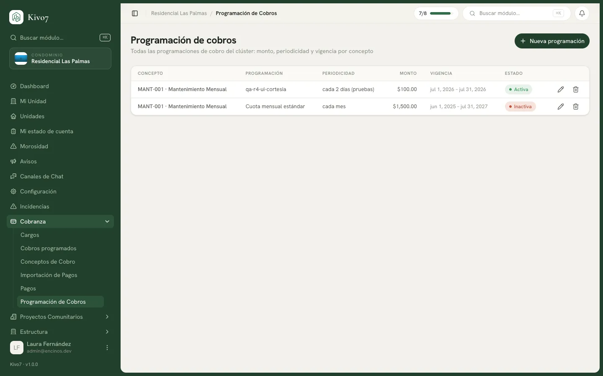

import { Steps, Aside, LinkCard, CardGrid } from '@astrojs/starlight/components';

La programación es donde vive todo el comportamiento de un cobro: el monto, a qué
casas alcanza, cada cuánto se repite, desde y hasta cuándo, cuántos días de
gracia hay y si aplican recargos.

Un concepto puede tener varias programaciones. La típica: una por año.

## Quién puede usarlo

| Acción | Quién |
|---|---|
| Crear, editar y eliminar programaciones | Administrador · Tesorero |
| Crear y editar (sin eliminar) | Presidente |
| Consultarlas | Los anteriores · Secretario · Vocal · Comité de Vigilancia |

## Crear una programación

<Steps>

1. Entra a **Programación de cobros** y presiona **Nueva programación**. También
   puedes llegar desde el concepto, con el icono de lista de su renglón.

2. Elige el **Concepto de cobro** al que pertenece.

3. Captura el **Nombre de la programación**. Ponle algo que distinga entre
   ejercicios: *Mantenimiento mensual 2026*.

4. Elige la **Periodicidad**:

   - **Mensual** — cada mes. Es la de la cuota de mantenimiento.
   - **Anual** — cada año.
   - **Eventual** — no se repite. Tú defines las fechas. Es la de una derrama.

5. Captura el **Monto fijo**: lo que paga cada casa.

6. Define los tiempos:

   - **Días de gracia** — cuántos días después del vencimiento se marca el cargo
     como moroso. Si lo dejas vacío, usa el del condominio.
   - **Días para «por vencer»** — con cuánta anticipación se avisa. Igual, vacío
     hereda del condominio.

7. Captura la **Vigencia**: **Vigente desde** y **Hasta**. En una programación
   eventual, en su lugar capturas **Fecha de generación** y **Vencimiento**.

8. Define el **Alcance del cobro** (ver abajo).

9. Si aplican, agrega los [recargos por mora](/docs/cobranza/recargos-por-mora).

10. Presiona **Crear programación**.

</Steps>

Mientras capturas, la columna derecha muestra la **Vista previa del ciclo**: la
línea de tiempo con los cuatro momentos por los que va a pasar cada cargo —
**Nace**, **Por vencer**, **Vence**, **Moroso** — con las fechas reales.

## El alcance: a quiénes les llega

Bajo **Alcance — ¿a quiénes aplica?** eliges entre siete opciones:

| Alcance | A quién alcanza |
|---|---|
| **Todo el condominio** | Todas las casas facturables |
| **Por tipo de unidad** | Uno o varios tipos: solo las casas, solo los locales |
| **Por torre** | Una o varias torres |
| **Por sección** | Una o varias secciones |
| **Por característica** | Las que tengan **alguna** de las características elegidas |
| **Con vehículos** | Las que tengan al menos un vehículo registrado |
| **Selección manual** | Las que elijas una por una |

Abajo aparece la vista previa en vivo: *Vista previa: N unidades incluidas*.
Úsala siempre — es la forma de cachar un alcance mal armado antes de emitir.

<Aside type="note">
**Por característica es "alguna", no "todas".** Si eliges *Alberca* y *Jardín*,
alcanza a las casas que tengan alberca **o** jardín, no solo a las que tengan las
dos.

Y **Todo el condominio** solo alcanza a las casas cuyo estado es facturable. Una
casa marcada como *Inactiva* queda fuera. → [Tipos y estados de unidad](/docs/estructura/tipos-y-estados-de-unidad)
</Aside>

## Qué se puede cambiar después

Mientras la programación **no haya generado cargos**, todo es editable.

En cuanto factura por primera vez, Kivo7 bloquea el **alcance** y la
**periodicidad**, y lo avisa en pantalla:

> Esta programación ya generó cobros: el alcance y la periodicidad quedan
> bloqueados. La vigencia y el monto siguen editables.

<Aside type="caution">
Es una restricción sana: cambiar el alcance de una regla que ya emitió dejaría
cargos huérfanos y descuadraría los reportes del periodo. Si de verdad necesitas
otro alcance, desactiva esta programación y crea una nueva.
</Aside>

## Ver lo que ha generado

Al abrir una programación existente, abajo aparece **Cobros generados**: cada
periodo que emitió, con su estado, su vencimiento y su avance de cobro. Cada
renglón se expande para ver los cargos casa por casa.

Es la forma rápida de contestar "¿ya se emitió lo de marzo?" sin salir de la
pantalla.

## Relacionado

<CardGrid>
  <LinkCard
    title="Recargos por mora"
    href="/docs/cobranza/recargos-por-mora"
    description="La penalización por pagar tarde, si tu reglamento la contempla."
  />
  <LinkCard
    title="Cobros programados"
    href="/docs/cobranza/cobros-programados"
    description="Emitir los cargos del periodo a partir de esta programación."
  />
</CardGrid>
