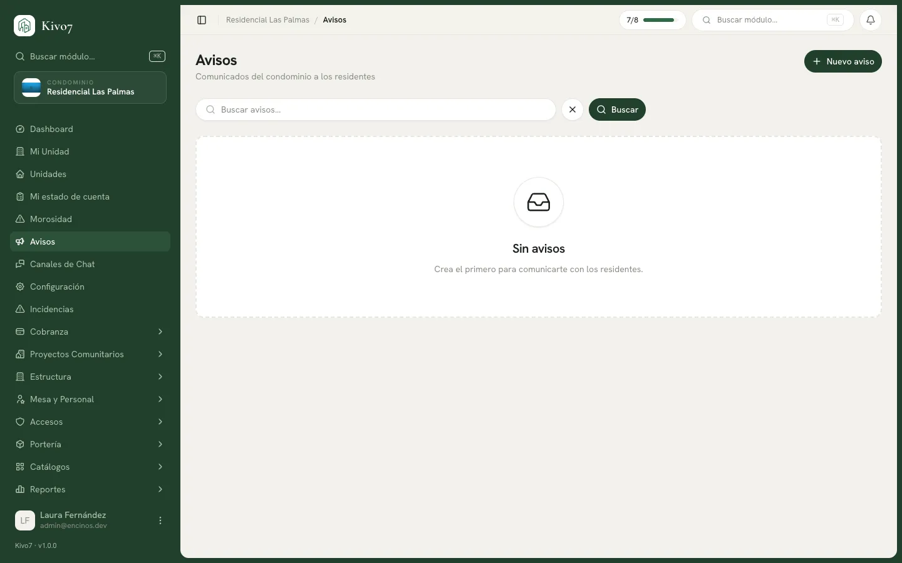

import { Steps, Aside, LinkCard, CardGrid } from '@astrojs/starlight/components';

Un aviso es un comunicado del condominio: el corte de agua del jueves, la
convocatoria a asamblea, el resultado de la votación.

A diferencia de un mensaje en el chat, queda ordenado, se puede dirigir a un
grupo y se sabe quién lo leyó.

## Quién puede publicarlos

| Rol | Puede |
|---|---|
| Administrador · Presidente | Crear, editar y publicar **cualquier** aviso |
| Tesorero · Secretario · Vocal | Crear y publicar, pero **solo los suyos** |
| Todos los demás | Solo leerlos |

<Aside type="note">
La restricción de "solo los suyos" también cubre editar, archivar y ver las
estadísticas de lectura. Si un vocal intenta tocar el aviso de otro:
*Solo el autor o la administración pueden modificar este aviso.*
</Aside>

## Crear y publicar

<Steps>

1. Entra a **Avisos** y presiona **Nuevo aviso**.

2. Captura el **Título**. *Corte de agua programado*.

3. Elige el **Tipo**: Aviso general, Asamblea, Mantenimiento, Financiero,
   Seguridad o Social / Evento.

4. Elige la **Prioridad**: **Normal**, **Importante** o **Urgente**.

5. Escribe el **Contenido**. Hay barra de formato: negrita, cursiva, subrayado,
   listas, enlaces, color y tamaño de texto.

6. En **Destinatarios**, define quiénes lo reciben. Además de los alcances
   habituales, aquí hay uno propio: **Solo la mesa directiva**.

7. Opcionalmente captura **Expira**, la fecha en que se archiva solo.

8. Agrega **Adjuntos** si hacen falta: hasta 5 archivos PDF o imagen, de 10 MB
   cada uno.

9. Presiona **Guardar borrador**.

10. Cuando esté listo, presiona **Publicar** desde la lista.

</Steps>

<Aside type="caution">
**Publicar no pide confirmación.** Un clic y sale. Revisa antes de presionarlo —
sobre todo los destinatarios.
</Aside>

## La prioridad cambia cómo llega

Es la decisión que más efecto tiene:

| Prioridad | Qué implica |
|---|---|
| **Normal** | Notificación en la aplicación y push |
| **Importante** | Además se manda por correo, aunque no lo pidas |
| **Urgente** | Correo, push forzado, **salta el horario de silencio** del vecino y aparece primero en el feed |

<Aside type="caution">
**Reserva "Urgente" para lo que de verdad lo amerita**: una fuga, un corte
imprevisto, una emergencia de seguridad. Salta el horario de silencio, así que un
aviso urgente a las once de la noche despierta a todo el condominio.

Úsalo tres veces por mes y la gente apaga las notificaciones. Ahí perdiste el
canal.
</Aside>

## Los canales de envío

El formulario ofrece tres casillas: **Push**, **Tablero** y **Correo**.

<Aside type="caution">
**Hoy solo "Correo" hace algo.** Las casillas de Push y Tablero se guardan pero
el sistema no las lee: el push sale siempre por la configuración general, y el
tablero muestra todo lo publicado.

Desmarcar **Push** no apaga el push. Es un defecto conocido; mientras se corrige,
la única palanca real es el correo — y la prioridad, que lo activa sola.
</Aside>

## Programar la publicación

<Aside type="caution">
**No se puede programar un aviso desde la aplicación.** El motor lo soporta y hay
un proceso que publica lo programado, pero **el formulario no tiene el campo de
fecha de publicación**.

En la práctica: guarda el borrador y publícalo tú el día que toque.
</Aside>

## Archivar

Los avisos publicados se archivan con un clic, o solos al llegar su fecha de
expiración. **Archivar no borra nada**: solo lo saca del feed activo.

## Si editas un aviso ya publicado

Kivo7 lo marca como editado y **le avisa a quienes ya lo habían leído**, con el
título *Aviso editado: (título)*.

<Aside type="tip">
Para una corrección de dedo no vale la pena: vas a notificar a todo el mundo otra
vez. Para un cambio de fondo —cambió la hora de la asamblea— sí, y es justo lo
que quieres.
</Aside>

## Se replica en el chat

Al publicar por primera vez, el aviso se copia automáticamente al canal de chat
**Avisos oficiales**, con sus adjuntos. Republicar no lo duplica.

## Relacionado

<CardGrid>
  <LinkCard
    title="Métricas de lectura"
    href="/docs/comunicacion/metricas-de-lectura"
    description="Quién lo leyó y quién no."
  />
  <LinkCard
    title="Chat comunitario"
    href="/docs/comunicacion/chat-comunitario"
    description="Donde se replican los avisos oficiales."
  />
  <LinkCard
    title="Notificaciones del condominio"
    href="/docs/comunicacion/notificaciones-del-condominio"
    description="Cómo se controla lo que se avisa y por qué canal."
  />
</CardGrid>
