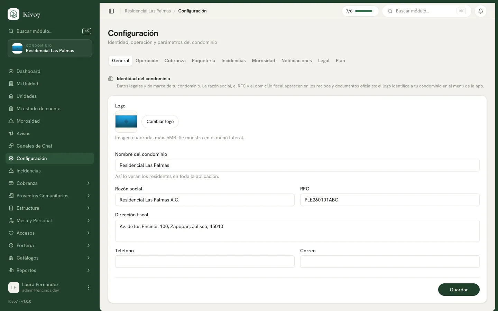

import { Aside, LinkCard, CardGrid } from '@astrojs/starlight/components';

La primera pestaña de **Configuración**. Son los datos legales y de marca de tu
condominio.

## Qué se configura

> Datos legales y de marca de tu condominio. La razón social, el RFC y el
> domicilio fiscal aparecen en los recibos y documentos oficiales; el logo
> identifica a tu condominio en el menú de la app.

- **Razón social** — el nombre legal del condominio.
- **RFC** — el registro fiscal.
- **Domicilio fiscal**.
- **Logotipo**.

## Quién puede editarla

Administrador y Propietario de la cuenta. Presidente y Tesorero la consultan.

## Por qué importa hacerlo primero

<Aside type="caution">
**La razón social y el RFC salen impresos en cada recibo de pago.** Si emites
tres meses de recibos con los datos mal, esos recibos ya están en manos de los
vecinos y no se pueden corregir hacia atrás.

Es uno de los nueve pasos de la
[configuración inicial](/docs/empezar/configuracion-inicial) precisamente por eso.
</Aside>

## El logotipo

Aparece en el menú de la aplicación y en los reportes generados. No es solo
estético: es lo que hace que un vecino reconozca que el correo o el PDF vienen de
su condominio y no de una plataforma anónima.

<Aside type="tip">
Sube una imagen cuadrada y con fondo transparente si puedes. Se muestra en
tamaños chicos, así que un logotipo con mucho texto se vuelve ilegible.
</Aside>

## Dónde aparecen estos datos

| Dato | Dónde se ve |
|---|---|
| Razón social | Recibos de pago, reportes en PDF |
| RFC | Recibos de pago |
| Domicilio fiscal | Documentos oficiales |
| Logotipo | Menú de la app, encabezado de los reportes |

## Relacionado

<CardGrid>
  <LinkCard
    title="Operación"
    href="/docs/configuracion/operacion"
    description="Zona horaria, moneda y tipo de condominio."
  />
  <LinkCard
    title="Documentos legales"
    href="/docs/configuracion/legal"
    description="Reglamento, acta constitutiva y aviso de privacidad."
  />
</CardGrid>
