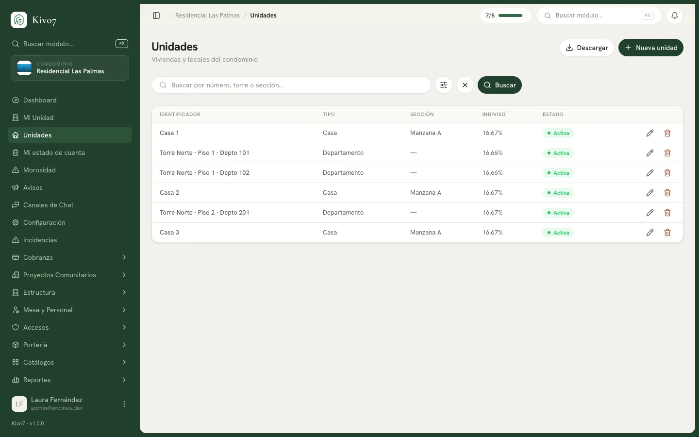

import { Steps, Aside, LinkCard, CardGrid } from '@astrojs/starlight/components';

Las unidades son las casas o departamentos del condominio. Todo lo demás cuelga
de aquí: la deuda pertenece a la casa, los residentes se asocian a la casa, los
vehículos y las visitas se registran por casa.

Darlas de alta bien la primera vez ahorra mucho después.

## Quién puede usarlo

| Acción | Quién |
|---|---|
| **Crear** una unidad | Administrador |
| **Editar** una unidad | Administrador · Presidente |
| Eliminar o restaurar | Administrador |
| Consultar y exportar | Administrador · Presidente |
| Consultar | Tesorero · Secretario · Vocal · Comité de Vigilancia · Seguridad |

<Aside type="note">
**Crear unidades es exclusivo del Administrador.** Ni el Presidente ni el Tesorero
ven el botón. Tiene sentido: dar de alta una casa cambia el conteo del plan y la
base de la cobranza.
</Aside>

## Antes de empezar

Necesitas al menos un [tipo de unidad](/docs/estructura/tipos-y-estados-de-unidad),
un estado y — si tu condominio las usa —
[torres o secciones](/docs/estructura/torres-y-secciones).

## El error más común: cómo se arma el identificador

<Aside type="caution">
**En el campo Número va solo el número. Nada más.**

Kivo7 antepone solo el nombre del tipo. Si el tipo se llama *Casa* y capturas
`23`, el identificador queda **Casa 23**.

Si capturas `Casa 23`, el identificador queda **Casa Casa 23** — y ya no hay forma
elegante de arreglarlo más que reeditando cada casa.
</Aside>

Cómo se arma, según el tipo:

| Tipo | Capturas | Se muestra |
|---|---|---|
| No vertical (*Casa*) | `23` | **Casa 23** |
| No vertical (*Local comercial*) | `4` | **Local comercial 4** |
| Vertical (*Departamento*) | torre `A`, piso `5`, número `502` | **Torre A · Piso 5 · Depto 502** |

Si dejas el número vacío, se muestra `s/n`.

## Dar de alta una unidad

<Steps>

1. Entra a **Unidades** y presiona **Nueva unidad**.

2. En **Identificación**:

   - Elige el **Tipo de unidad**.
   - Si el tipo es vertical, captura **Torre** y **Piso** (obligatorios).
   - Captura el **Número** — solo el número. En los tipos verticales este campo
     se llama **Número de depto**.
   - Captura el **Número interior** si la vivienda tiene uno (opcional).
   - Captura la **Calle** si la vivienda se ubica por calle (opcional).
   - Opcionalmente elige **Sección / Manzana**.
   - Elige el **Estado**.

3. En **Datos físicos**, ambos opcionales: **M² construcción** y **M² terreno**.

4. En **Características**, marca las que apliquen o agrega las tuyas.

5. Captura **Notas** si hace falta.

6. Presiona **Guardar unidad**.

</Steps>

Al crear, Kivo7 te lleva directo al detalle de la casa para que asocies a las
personas.

## Calle y número interior

Son los dos datos de dirección de la vivienda y **ambos son opcionales**: si los
dejas vacíos, la unidad se guarda igual y nadie queda bloqueado.

| Campo | Para qué sirve | Ejemplo |
|---|---|---|
| **Calle** | La vialidad donde está la vivienda. Sirve sobre todo en fraccionamientos horizontales, donde a las casas se les llega por calle y no por un número corrido. | `Av. de los Cedros` |
| **Número interior** | El complemento del número cuando la vivienda tiene número exterior e interior. El **Número** guarda el exterior; este, el interior. | `4-B` |

Dónde se ven después de capturarlos:

- En el **detalle de la unidad**, en la tarjeta **Información general**, justo
  debajo de **Número**. Si el campo está vacío, la fila no aparece.
- En el Excel del botón **Descargar**, como columnas **Calle** y
  **Número interior**.
- En el buscador de la lista de **Unidades**: puedes escribir el nombre de la
  calle o el número interior y encontrar la vivienda.

<Aside type="note">
**No cambian el identificador de la casa ni su identidad.** La vivienda se sigue
llamando **Casa 23** o **Torre A · Piso 5 · Depto 502**: el identificador no
incluye la calle ni el número interior.

Tampoco sirven para distinguir dos unidades. Dos viviendas siguen sin poder
repetir tipo, torre, piso y número, aunque las captures en calles distintas.
</Aside>

## Las características

El formulario ofrece cuatro sugerencias — *Cochera doble*, *Esquina*, *Frente a
calle principal*, *Acceso para discapacitados* — y un campo para agregar las
tuyas.

<Aside type="note">
Estas características son texto libre del formulario. Existe además un catálogo
aparte llamado
[Características de Unidad](/docs/estructura/caracteristicas-de-unidad), que hoy
**no está conectado a este formulario**. Si vas a usar características para
cobrar por grupo, revisa esa página antes.
</Aside>

## Buscar y exportar

El buscador encuentra por número, número interior, calle, torre o sección. Hay
tres filtros: **Tipo de unidad**, **Estado** y **Torre**.

El botón **Descargar** exporta a Excel con el identificador, el número, el número
interior, la calle, tipo, torre, piso, sección, metros, estado y fecha de
creación.

## Eliminar una unidad

Solo si nunca tuvo movimiento. Con historial financiero, Kivo7 lo impide:

> No se puede eliminar una unidad con histórico de cargos o pagos. Márcala como
> inactiva.

Ese es el camino correcto: cambiarle el estado a uno no facturable, que la saca
de la cobranza y conserva su historia.

## Si te dice que ya existe

> Ya existe una Casa 23 en este condominio.

Dos casas no pueden compartir tipo, torre, piso y número. Revisa si ya la
capturaste, quizá con otro tipo. Ponerles calles distintas no destraba el
mensaje: la calle no entra en esa combinación.

## Relacionado

<CardGrid>
  <LinkCard
    title="Residentes"
    href="/docs/estructura/residentes"
    description="El siguiente paso: asociar personas a cada casa."
  />
  <LinkCard
    title="Límite de unidades de tu plan"
    href="/docs/estructura/limite-de-unidades"
    description="Qué pasa cuando te pasas del tope contratado."
  />
  <LinkCard
    title="Cambio de propietario"
    href="/docs/estructura/cambio-de-propietario"
    description="Cuando una casa se vende."
  />
</CardGrid>
