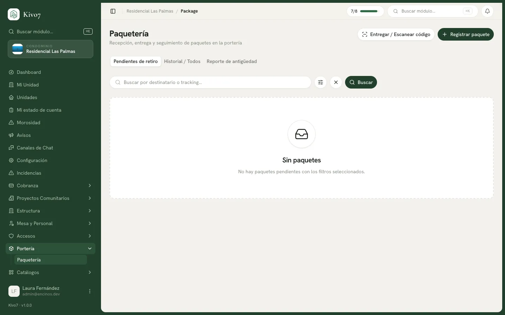

import { Steps, Aside, LinkCard, CardGrid } from '@astrojs/starlight/components';

Registrar un paquete es el momento en que el condominio se hace responsable de
él. A partir de ahí queda con su casa, su código de retiro y su reloj.

## Quién puede usarlo

| Acción | Quién |
|---|---|
| Registrar y entregar | **Seguridad** · Administrador |
| Consultar y ver reportes | Presidente · Tesorero · Comité de Vigilancia |
| Ver los suyos | Residente · Arrendatario |

El vigilante es el operador principal. La mesa directiva supervisa sin registrar.

## Registrar uno

<Steps>

1. Entra a **Paquetería** y presiona para registrar, en la pestaña
   **Individual**.

2. Elige la **Unidad**. Es el único campo obligatorio.

3. Captura lo que ayude a identificarlo:

   - **Transportista** — DHL, FedEx, UPS, Estafeta, J&T Express, Amazon
     Logistics, MercadoEnvíos, u **Otro** con el nombre libre.
   - **Tipo de paquete** — Caja pequeña, Caja grande, Sobre / paquete plano,
     Bolsa u Otro.
   - **Nombre del destinatario** — el que viene escrito en el paquete.
   - **Número de rastreo**.
   - **Ubicación de almacén** — *Estante A-3*. Es el dato que hace rápida la
     entrega.
   - **Descripción** — *Paquete grande, frágil*.

4. Toma la **Foto del paquete** si tu protocolo lo pide.

5. Presiona **Registrar**.

</Steps>

<Aside type="tip">
De todos los campos opcionales, el que más rinde es la **Ubicación de almacén**.
Con veinte paquetes en la caseta, es la diferencia entre entregar en treinta
segundos o revolver el estante.
</Aside>

## Registrar por lote

Para cuando llega el camión con quince paquetes de una vez.

<Steps>

1. Cambia a la pestaña **Lote (hasta 50)**.

2. Llena cada renglón con la **Unidad** —lo único obligatorio— y lo que puedas:
   Transportista, Tipo, Destinatario, Rastreo y Almacén.

3. Presiona **Agregar paquete** para sumar renglones.

4. Presiona el botón de registro con el total.

</Steps>

<Aside type="note">
Dos límites del modo lote: **no admite foto** —la pantalla lo advierte— y **no
ofrece la opción "Otro" de transportista**. Si necesitas cualquiera de las dos
cosas, registra ese paquete por separado.

Y algo bueno: **el lote es todo o nada**. Si un renglón falla, no se guarda
ninguno. No te quedas con la carga a medias sin saber cuáles entraron.
</Aside>

## Qué pasa al registrar

1. El paquete queda en estado **Listo para recoger**.
2. Se genera su **código de retiro**, si el condominio lo tiene activado.
3. Se le **avisa al residente** que tiene un paquete esperando, si el aviso
   automático está activo.
4. Empieza a correr el reloj para el recordatorio y para la devolución.

## Si la casa tiene adeudo vencido

Cuando el condominio activó las
[restricciones por morosidad](/docs/cobranza/restricciones-por-morosidad)
incluyendo paquetería, el registro se bloquea con un mensaje corto:

> Esta unidad no puede recibir paquetes.

<Aside type="note">
El mensaje es breve **a propósito** y no dice cuánto se debe: el vigilante nunca
ve el adeudo de un residente. Exponerlo frente a un repartidor sería un problema
de privacidad.
</Aside>

## Relacionado

<CardGrid>
  <LinkCard
    title="Entregar un paquete"
    href="/docs/paqueteria/entregar-un-paquete"
    description="El retiro verificado con código y firma."
  />
  <LinkCard
    title="Configuración de paquetería"
    href="/docs/configuracion/paqueteria"
    description="Código de retiro, firma, evidencia y plazos."
  />
  <LinkCard
    title="Reporte de antigüedad"
    href="/docs/paqueteria/reporte-de-antiguedad"
    description="Qué lleva demasiado tiempo sin recogerse."
  />
</CardGrid>
