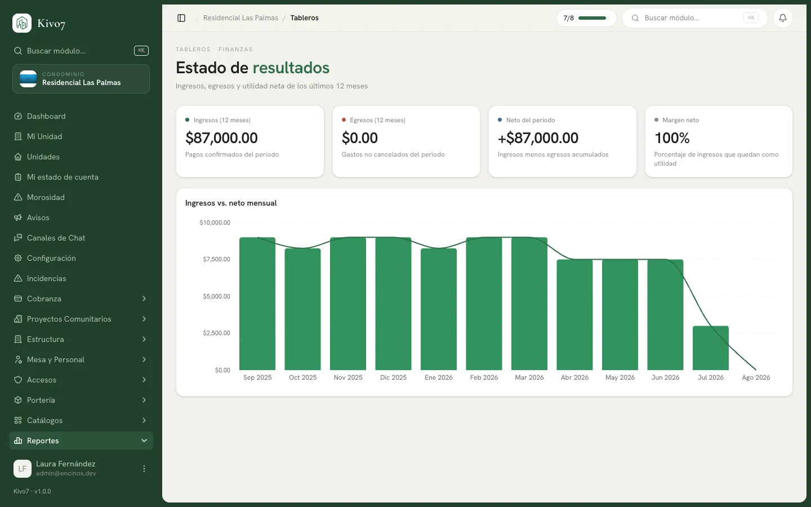

import { Aside, LinkCard, CardGrid } from '@astrojs/starlight/components';

Los tableros son consulta rápida: entras, ves cómo va el condominio y sales. No
generan archivos ni se pueden filtrar.

## Los cinco

### Estado de resultados

*Ingresos, egresos y utilidad neta de los últimos 12 meses.*

**Ingresos (12 meses)** · **Egresos (12 meses)** · **Neto del periodo** ·
**Margen neto** en porcentaje.

Gráfica de **Ingresos vs. neto mensual**.

Es el tablero que contesta "¿el condominio está sano?".

### Flujo de caja

*Saldos, entradas y salidas de los últimos 12 meses.*

**Saldo total** · **Cuentas activas** · **Entradas del mes** · **Salidas del
mes**.

Dos gráficas —evolución del saldo acumulado y entradas contra salidas— y el
desglose por cuenta bancaria con su total.

Es el que contesta "¿cuánto hay y de dónde sale?".

### Desglose de gastos

*Egresos por categoría, proveedor y tendencia mensual.*

**Gasto del periodo** · **Gasto recurrente** · **% recurrente** · **Proveedores
activos**.

Gráficas por categoría, por proveedor y de tendencia mensual.

<Aside type="tip">
El indicador **% recurrente** es el más útil y el que nadie mira: dice qué
proporción del gasto es fija —jardinero, vigilancia, luz— frente a lo eventual.
Un condominio con 90% recurrente tiene poco margen de maniobra si sube una cuota.
</Aside>

### Cartera vencida

*Aging y morosidad actual del condominio.*

**Cartera vencida** · **Tasa de cobro** · **Unidades morosas** · **Antigüedad
promedio**.

La gráfica de **antigüedad de cartera** parte el adeudo en tramos: Al corriente,
1–30 días, 31–60, 61–90 y +90. Y una tabla con los **principales deudores**.

<Aside type="tip">
La forma de la gráfica de antigüedad dice más que el total. Mucho en 1–30 días es
normal; mucho en +90 días es cartera que probablemente ya no se cobra sola y
necesita otra estrategia.
</Aside>

### Proyectos comunitarios

*Avance de financiamiento y estado de los proyectos.*

**Proyectos activos** · **Meta total** · **Recaudado** · **Avance global**.

Gráficas de recaudado contra meta por proyecto y distribución por estado, más la
tabla de detalle.

## Quién los ve

Administrador, Presidente, Tesorero y Comité de Vigilancia. Cada tablero tiene su
propio permiso, así que se pueden repartir por separado.

Si a alguien le falta: *No tienes acceso a este tablero.*

## Sin filtros y sin periodo

<Aside type="caution">
**Los cinco tableros son de solo lectura y con periodo fijo.** No hay selector de
fechas ni ningún filtro.

Resultados, Tesorería y Gastos siempre muestran **los últimos 12 meses**;
Cobranza y Proyectos, el **estado actual**.

Para otro periodo, hay que ir al módulo correspondiente y exportar con sus
filtros.
</Aside>

## Tablero o reporte

| Necesitas | Usa |
|---|---|
| Ver cómo va el condominio en 30 segundos | **Tablero** |
| Un documento con folio para la asamblea | [Reporte](/docs/reportes/generar-y-descargar) |
| Trabajar los datos en Excel | Reporte, o el export del módulo |
| Enseñar una tendencia en una junta | **Tablero**, proyectado |
| Publicar para los vecinos | [Reporte en el tablero de avisos](/docs/reportes/publicar-en-el-tablero) |

## Relacionado

<CardGrid>
  <LinkCard
    title="Catálogo de reportes"
    href="/docs/reportes/catalogo-de-reportes"
    description="Cuando necesitas un documento, no una vista."
  />
  <LinkCard
    title="Morosidad"
    href="/docs/cobranza/morosidad"
    description="El detalle casa por casa que el tablero resume."
  />
</CardGrid>
