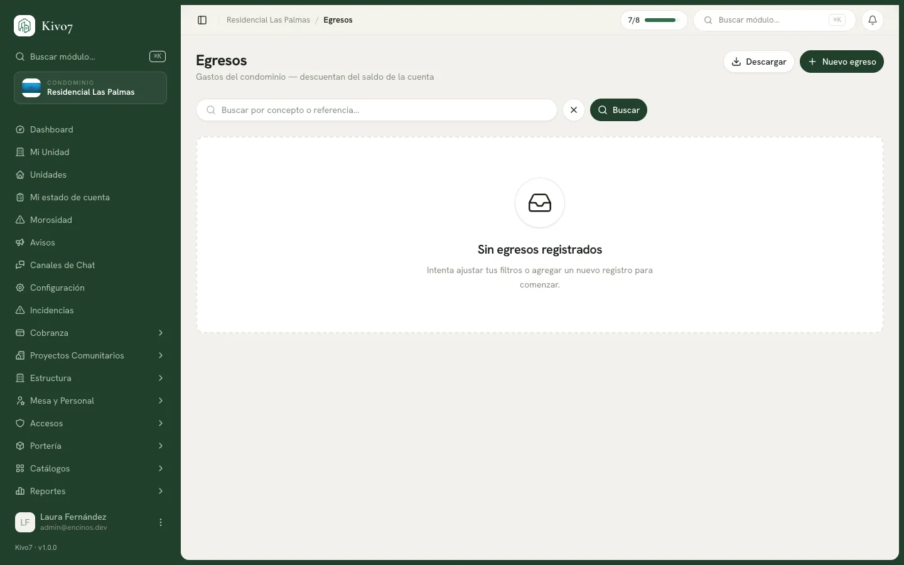

import { Steps, Aside, LinkCard, CardGrid } from '@astrojs/starlight/components';

Un egreso es cada peso que sale del condominio: el pago al jardinero, la luz de
las áreas comunes, la compra de cloro para la alberca. Cada egreso descuenta del
saldo de la cuenta de la que salió.

## Quién puede usarlo

| Acción | Quién |
|---|---|
| Registrar y editar egresos | Administrador · Tesorero · Presidente |
| **Anular** un egreso | Administrador · Presidente |
| Consultar y descargar | Los anteriores · Comité de Vigilancia (solo consultar) |

<Aside type="note">
El **Tesorero registra los gastos pero no puede anularlos**. Anular revierte
dinero, así que esa facultad queda en el Presidente y el Administrador. Es la
separación de funciones que pide cualquier auditoría.
</Aside>

## Registrar un egreso

<Steps>

1. Entra a **Egresos** y presiona **Nuevo egreso**.

2. Captura el **Concepto**: qué se pagó, en una línea. *Pago de jardinería marzo*.

3. Captura el **Monto** y la **Fecha de pago**.

4. Elige la **Categoría**: Salarios, Servicios públicos, Mantenimiento, Insumos,
   Bancarias, Imprevistos o Proyectos. De aquí salen los reportes de gastos, así
   que vale la pena elegir bien.

5. Elige el **Tipo de beneficiario** y con él, quién recibió el dinero:

   - **Empleado** → seleccionas a la persona del directorio de colaboradores.
   - **Proveedor** → seleccionas del catálogo de proveedores.
   - **Otro** → escribes el nombre libremente. *CFE*, *Telmex*.

6. Elige el **Método de pago** y la **Cuenta origen**, la cuenta de donde salió
   el dinero.

7. Captura la **Referencia** si hubo transferencia, y sube el **Comprobante** con
   **Subir factura / recibo**.

8. Presiona **Registrar egreso**.

</Steps>

El saldo de la cuenta baja de inmediato.

## Qué se puede corregir y qué no

Aquí está la regla que más sorprende: **el monto, la fecha, la cuenta de origen,
el método de pago y la referencia son inmutables**. Una vez registrado el egreso,
esos campos no se editan.

Solo puedes corregir lo cosmético: el concepto, la descripción, las notas, la
categoría y el beneficiario.

Si te equivocaste en el monto o en la cuenta, el camino es **anular y volver a
capturar**. Kivo7 lo dice literal al intentarlo: *Este campo no se puede editar;
anula el egreso y regístralo de nuevo.*

<Aside type="tip">
No es una limitación arbitraria: si el monto fuera editable, el saldo de la
cuenta dejaría de cuadrar con los movimientos. Al forzar anular y recapturar,
queda el rastro de la corrección.
</Aside>

### La ventana del mismo día

Quien no puede anular — es decir, el Tesorero — **solo puede editar egresos
capturados hoy**. Al día siguiente el sistema responde: *Solo puedes editar
egresos capturados hoy. Para corregir un egreso anterior, anúlalo y regístralo de
nuevo.*

En la práctica significa que el Tesorero tiene el día para corregir sus propias
capturas, y después necesita al Presidente o al Administrador.

## Anular un egreso

<Steps>

1. En la lista, presiona el botón rojo de anular del renglón.

2. Lee el aviso: *El egreso «...» de $X quedará anulado y el saldo de la cuenta
   se restaurará. La operación queda en auditoría.*

3. Escribe el **motivo de la anulación**. Es obligatorio.

4. Presiona **Anular egreso**.

</Steps>

El monto se devuelve al saldo de la cuenta y el egreso queda marcado como
**Anulado**, atenuado en la lista pero visible.

<Aside type="caution">
**Los egresos nunca se borran, solo se anulan.** No hay botón de eliminar y el
sistema lo rechaza si se intenta por otra vía. Un gasto que desaparece sin rastro
es exactamente lo que un condominio no puede permitirse.
</Aside>

## Estados

| Estado | Qué quiere decir |
|---|---|
| **Pagado** | El gasto está registrado y ya descontó del saldo. |
| **Anulado** | Se revirtió. El monto volvió a la cuenta y el motivo quedó registrado. |

## Cuando Kivo7 sospecha de un duplicado

Si registras un egreso al **mismo proveedor**, del **mismo periodo**, con un monto
parecido (dentro del 10%) y otro igual se capturó en los últimos 7 días, el
sistema se detiene y avisa que puede ser un duplicado.

No te bloquea: te pide confirmar. Es la red que atrapa el clásico "pagamos dos
veces al jardinero porque cada quien capturó lo suyo".

## Avisos automáticos

- **Egreso mayor a $5,000.00 MXN** → aviso al Presidente: *Se registró un egreso
  de $X: (concepto).*
- **Saldo de la cuenta por debajo de $10,000.00 MXN** → aviso al Tesorero, al
  Presidente y al Administrador.

## Comprobantes

Cada egreso admite un **comprobante** (PDF, JPG, PNG o WEBP, hasta 10 MB) y, por
separado, la **factura CFDI** (PDF y XML). Los archivos se descargan después
desde los botones del renglón.

<Aside type="caution">
La subida del comprobante desde la interfaz está en revisión: hay indicios de que
el formulario no envía toda la información que el servidor espera. Verifica que
tu archivo quedó adjunto antes de confiar en él, y si falla, guarda la factura
por fuera mientras se corrige.
</Aside>

## Relacionado

<CardGrid>
  <LinkCard
    title="Cuentas bancarias y caja"
    href="/docs/tesoreria/cuentas-bancarias"
    description="De dónde sale el dinero y cómo se recalcula el saldo."
  />
  <LinkCard
    title="Categorías de egreso"
    href="/docs/tesoreria/categorias-de-egreso"
    description="La clasificación que después da los reportes."
  />
  <LinkCard
    title="Proveedores"
    href="/docs/tesoreria/proveedores"
    description="El directorio de quienes le prestan servicios al condominio."
  />
</CardGrid>
